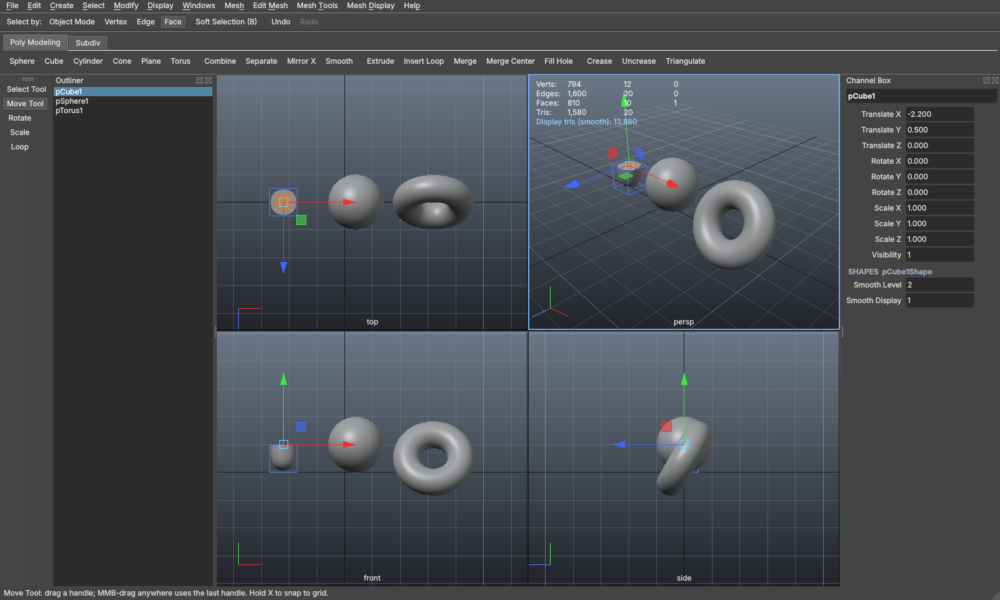
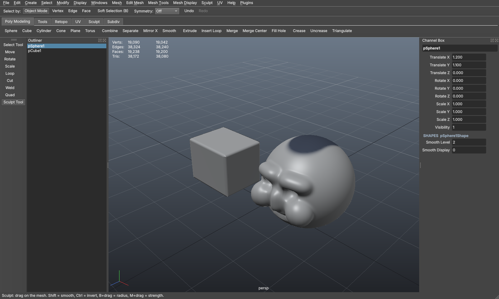
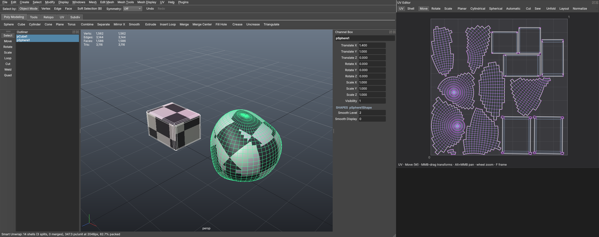
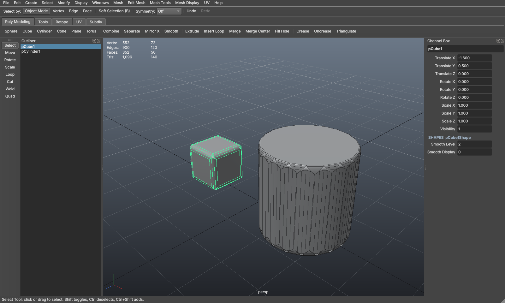
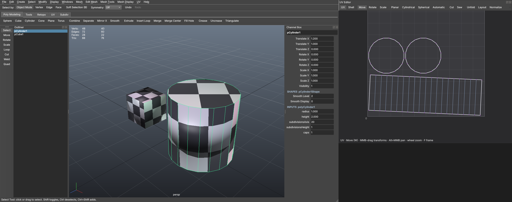
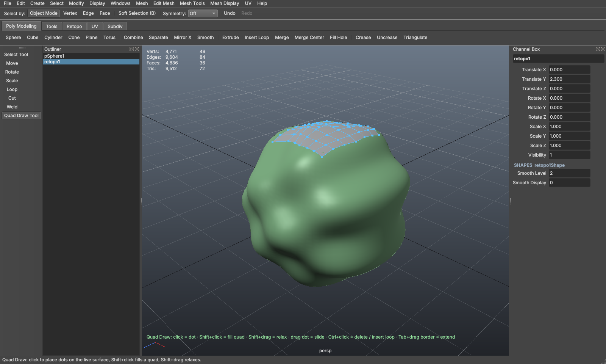

# Facet

A personal desktop 3D modeler for subdivision and high-poly work, with **Maya-style
interaction**: the same camera controls, hotkeys, marking menus, hotbox, component modes,
Channel Box and Outliner workflow. It is a standalone app written in C++20, Qt 6 and OpenGL 4.1.



## Build

Requirements: a C++20 compiler, CMake ≥ 3.21, Qt 6 (Widgets, OpenGL, OpenGLWidgets), OpenGL 4.1.

**macOS**

```sh
brew install qt cmake ninja
cmake -S . -B build -G Ninja -DCMAKE_PREFIX_PATH="$(brew --prefix qt)"
cmake --build build
open build/Facet.app
```

**Windows** (Visual Studio 2022 + Qt online installer, MSVC 64-bit kit)

```bat
cmake -S . -B build -DCMAKE_PREFIX_PATH=C:\Qt\6.7.2\msvc2019_64
cmake --build build --config Release
C:\Qt\6.7.2\msvc2019_64\bin\windeployqt build\Release\Facet.exe
build\Release\Facet.exe
```

**Linux** (Ubuntu 24.04)

```sh
sudo apt install cmake ninja-build qt6-base-dev libgl-dev
cmake -S . -B build -G Ninja && cmake --build build
./build/Facet
```

Command-line options: `Facet scene.facet`, `Facet model.obj|model.fbx`, `Facet --demo [faces|soft|bevel|uv|retopo]`,
`Facet --quad`, `Facet --screenshot out.png`.

### Tests

```sh
./build/facet_tests                 # geometry core: topology, subdivision, bevel/bridge/cut, UV tools, BVH
./build/facet_iotests               # FBX binary round trip (incl. hard edges) + ASCII FBX parsing
./build/facet_plugintests           # loads the Smart Unwrap plugin and benchmarks it vs. automatic mapping
xvfb-run -a ./build/facet_uitests   # drives the real window with synthesized mouse/keys
```

The UI tests click, marquee, drag gizmos (with symmetry), extrude, bevel, multi-cut, target-weld,
quad-draw on a live surface, transform UVs in the UV Editor, export/import FBX, use marking-menu
gestures and check hotkeys against the real viewport and its GPU picking.

FBX output has also been validated against an independent reader (Assimp), and FBX files written
by Assimp (binary 7.5 and ASCII) import correctly.

## What's in v0.1

**Modeling core (built for dense meshes)**
- Index-based half-edge mesh with n-gons, borders and non-manifold tolerance; parallel normals.
- Catmull–Clark subdivision with **semi-sharp creases** (Pixar rules: crease 1/2/3/full).
  Topology is refined once and cached, so dragging vertices only re-evaluates positions:
  a 100k-quad cage → 1.6M-quad smooth surface re-evaluates in ~10 ms.
- Ops: Extrude (together / individual), Insert Edge Loop (interactive with slide preview),
  Delete faces, dissolve edges and vertices, Merge by distance, Merge to Center, Collapse,
  Fill Hole, Mirror (welded seam), Combine, Separate, Smooth (bake), Triangulate,
  Reverse normals, Freeze / Reset transforms, Center pivot.
- Primitives with **construction history**: edit the INPUTS (subdivisions, radius…) in the
  Channel Box and the mesh regenerates, until you edit components (as in Maya).

**Hard-surface & topology tools**
- **Bevel** (Ctrl+B): offset, segments, round profile; handles edge loops, corners where 2–3+
  bevelled edges meet, and edges ending at unbevelled vertices.
- **Bridge**: two border edge loops/chains or two face regions, with divisions.
- **Multi-Cut**: click edge/vertex points to cut through faces (Shift = 10% snapping,
  Ctrl+click = full edge loop, Enter/RMB to commit).
- **Target Weld**: drag one vertex onto another.
- **Symmetry** (status line / Mesh Tools): object X/Y/Z. Selection and all component transforms
  are mirrored, and seam vertices stay on the plane.

**Hard / soft edges** (Mesh Display menu, Tools shelf, edge marking menu)
- Per-edge hardness with split normals in the viewport: Harden Edge, Soften Edge, and Set Normal
  Angle (edges sharper than N degrees go hard). Works on selected edges, or whole objects in
  object mode. "Show Hard Edges" highlights them.
- Maya-like defaults: cube edges and cylinder/cone caps are hard; curved primitives are soft.
  Bevel hardens only sharp boundaries (30°), and rounded bevels shade smoothly.
- Kept through every modeling op, saved in scenes, and exported to FBX as per-edge smoothing
  (Maya reads it as soft/hard). On FBX import, hard edges come from the smoothing layer or are
  recovered from split normals (Blender, Unity and Unreal exports).

**Plugins** (Plugins menu, Plugin Manager)
- Plugins are Qt shared libraries implementing `src/plugin/PluginApi.h`. Facet loads them from
  `plugins/` next to the executable, `<build>/plugins`, or `FACET_PLUGIN_PATH`.
- Each plugin command appears in the Plugins menu and in the menu it names, gets an options
  dialog generated from its declared options, and runs on copies of the selected meshes as one
  undo step.
- Plugins link only against the geometry core (`facet_core`, a shared library) and QtCore.

**Sculpting** (Sculpt menu, Sculpt shelf, Sculpt tool in the tool box)
- Brushes: Draw, Smooth, Grab, Inflate, Flatten, Pinch, Crease and Mask.
- Maya-style controls: drag to sculpt, Shift for smooth, Ctrl to invert, B+drag for radius,
  M+drag for strength. The brush circle and settings show in the viewport.
- Respects Symmetry (status line). Masked areas are protected and shown darker; there are
  Invert/Clear Mask commands.
- Strokes hit the surface through the GPU depth buffer, so aiming stays exact on dense meshes.
  Vertices are found through a spatial grid: about 1 ms per dab on a 1M-vertex mesh.
- Each stroke is one undo step. "Subdivide for Sculpting" bakes another subdivision level for
  more detail.

**Weighted normals** (Mesh Display > Weighted Normals): large faces dominate shared vertex
normals, so big flat panels shade perfectly flat next to small soft bevels, without hard edges.
It is a live setting, recomputed as you edit, and is exported to FBX and saved with the scene.



**Smart Unwrap plugin** (`plugins/smart_unwrap`, also in the UV menu): automatic mapping that
produces good shells and uniform texel density.
1. Grows shells by curvature (best-first, by normal deviation), stopping at hard edges and
   optionally at existing seams. Fragment-sized shells merge into neighbours.
2. Unfolds each shell in world space with LSCM, solved by IC(0)-preconditioned conjugate gradients.
3. Splits a shell recursively if it has flipped faces or too much area or angle distortion.
4. Scales every shell to the same world-space texel density, so non-uniformly scaled objects
   also come out right.
5. Packs shells with a shape-aware raster packer (4 rotations, padding in texture pixels) and
   binary-searches the largest density that fits. "Pack together" gives several objects one
   shared density.

Benchmark (`facet_plugintests`), Automatic → Smart Unwrap:

| Mesh | Area / angle distortion | Coverage of 0–1 | Density spread |
|---|---|---|---|
| Sphere | 1.13 / 1.24 → 1.06 / 1.02 | 52% → 53% | 0.001 → 0 |
| Torus | 1.11 / 1.19 → 1.04 / 1.02 | 48% → 55% | 0.001 → 0 |
| Rounded box | 1.08 / 1.06 (0.45% overlap) → 1.00 / 1.00 | 63% → 62% | 0.012 → 0 |
| Lumpy sculpt | 16 flipped faces → 1.06 / 1.01 | 40% → 59% | 0.010 → 0 |
| Scaled cylinder | 1.44 / 2.47 → 1.00 / 1.00 | 68% → 66% | 0.232 → 0 |

32k faces unwrap in about 2 s. UV quality metrics are available to plugins as `uv::measure()`.



**UVs** (UV menu, UV shelf, and a floating **UV Editor**, Ctrl+Shift+U)
- Face-varying UVs kept through every modeling op, through subdivision and through OBJ/FBX.
- Planar (X/Y/Z/best), Cylindrical, Spherical and Automatic projections, on selected faces or
  the whole mesh.
- Cut and Move-and-Sew along selected edges; **Unfold** (Least Squares Conformal Maps, area
  preserving); **Layout** (uniform texel density, rotation for tight boxes, shelf packing);
  Normalize, Flip, Rotate 90.
- UV Editor with UV and UV-shell selection, W/E/R transforms (MMB drag), undo, and UV borders
  drawn thick.
- `6` shows a UV checker in the viewport.

**Retopology**
- **Make Live** turns a high-poly mesh into a snap surface (BVH ray casts and closest-point queries).
- **Quad Draw**: click to drop dots on the surface, Shift+click to fill a quad from the nearest
  four, Shift+drag to relax (re-projected onto the surface), drag a vertex to slide it on the
  surface, Ctrl+click to delete a vertex or insert an edge loop, Ctrl+Shift+click to delete a
  face, Tab+drag on a border edge to extend a strip.
- **Conform** snaps any mesh or component selection onto the live surface.

**FBX** (File > Import / Export)
- Reads binary FBX (7.x, including 7.5's 64-bit headers and zlib arrays) and ASCII FBX. It imports
  polygons, the first UV set, transforms, pre-rotation and parenting (baked into each object), and
  welds split vertices from game-engine exports.
- Writes binary FBX 7.4 with geometry, smooth normals, UVs ("map1"), a lambert material and
  per-object transforms.
- Not yet: creases, multiple UV sets, materials beyond a default lambert, skinning or animation.





**Maya-style interaction**

| Input | Action |
|---|---|
| Alt + LMB / MMB / RMB, wheel | Tumble / track / dolly |
| F, A (Shift = all views) | Frame selected / all |
| Space tap / hold | Four-view toggle (maximize panel under cursor) / Hotbox |
| Q W E R | Select / Move / Rotate / Scale |
| MMB-drag (no Alt) | Drive the last-used manipulator handle from anywhere |
| X / J held | Grid snap while moving / 15° rotate snap |
| F8, F9, F10, F11 | Object↔component, vertex, edge, face |
| Ctrl+F9/F10/F11 | Convert selection |
| Shift / Ctrl / Ctrl+Shift click | Toggle / deselect / add |
| Double-click edge | Select edge loop |
| > / < | Grow / shrink selection |
| B tap, B + LMB drag | Soft selection on/off, falloff radius (world-space, coloured falloff) |
| RMB | Marking menu: component modes |
| Shift + RMB | Marking menu: modeling tools for the current mode |
| Ctrl + RMB | Marking menu: convert selection |
| Ctrl+E | Extrude (manipulator switches to normal orientation) |
| Ctrl+B | Bevel |
| 6 | UV checker display |
| Ctrl+Shift+U | UV Editor (inside it: W/E/R, F, A, Alt+MMB pan, wheel zoom) |
| Ctrl+I | Import FBX / OBJ |
| Sculpt tool | drag = brush, Shift = smooth, Ctrl = invert, B+drag radius, M+drag strength |
| G | Repeat last command |
| 1 / 2 / 3, PgUp / PgDn | Smooth preview off / cage + smooth / smooth, smooth level |
| 4 / 5 | Wireframe / shaded |
| Alt+X, Alt+B | X-ray, cycle background |
| Z, Shift+Z (and Ctrl+Z / Ctrl+Shift+Z) | Undo / redo |
| Ctrl+D, Delete, Ctrl+H / Shift+H | Duplicate, delete, hide / show all |

Marking menus work as gestures (press, flick, release) or as click menus (quick click).
Channel Box labels are virtual sliders: drag a label to scrub the value.
Selection uses an integer GPU ID buffer: marquee picks **only visible** components unless
X-ray or wireframe is on, and components under the cursor get a red pre-selection highlight.
The HUD shows cage counts plus the smooth-preview triangle count.

Platform notes: on macOS, Maya's Ctrl shortcuts are on ⌘, Alt is ⌥, and F8–F11 may need
`fn`. On Linux, if your window manager uses Alt+drag to move windows, rebind it to Super.

## Architecture

```
src/math      Vec/Mat/AABB/Ray (no dependencies)
src/mesh      Mesh (half-edge + face-varying UVs), Subdivision, MeshOps, BevelBridge, UVOps (LSCM),
              BVH, Primitives, ObjIO   ← pure C++, unit-tested
src/io        FBX reader (binary + ASCII) and binary 7.4 writer (Qt zlib)
src/plugin    Plugin API (header-only)            plugins/smart_unwrap   Smart Unwrap plugin
src/scene     Scene, objects + construction history, undo commands, Modeling (high-level commands)
src/render    OpenGL 4.1 core renderer: studio-lit shading, cage/smooth wires, overlays, ID pick pass
src/viewport  Viewport widget: cameras, picking, manipulators, tools, HUD
src/ui        MainWindow (menus/shelf/status line), MarkingMenu + Hotbox, Outliner, ChannelBox
```

The geometry core has no Qt dependency, so it can later be driven by a Python layer or a
headless batch tool. GPU and subdivision caches are keyed on globally unique mesh version ids,
so undo/redo just swaps mesh snapshots and everything stays in sync.

## Roadmap (high-poly / VFX priorities)

1. Baking: normal / displacement / AO maps from high-poly to low-poly (ray cast via the BVH).
2. Sculpt: multires levels, dynamic topology, layers, alphas/stencils, pen pressure.
3. Offset Edge Loop, Slide Edge, Poke, Wedge; bevel with chamfer-mitering options; world-space symmetry.
4. **Sculpting**: multires / dynamic-tessellation brushes (grab, smooth, crease, inflate, clay) on millions of polys, with masks and layers.
5. UV: optimize (ARAP), straighten shells, texel-density tools, UDIM tiles, image textures.
6. FBX: creases, multiple UV sets, materials/textures; USD and Alembic.
7. Python scripting (`cmds`-like) and a Script Editor; customizable hotkeys and shelves.
8. GPU subdivision via OpenSubdiv for very dense previews.
